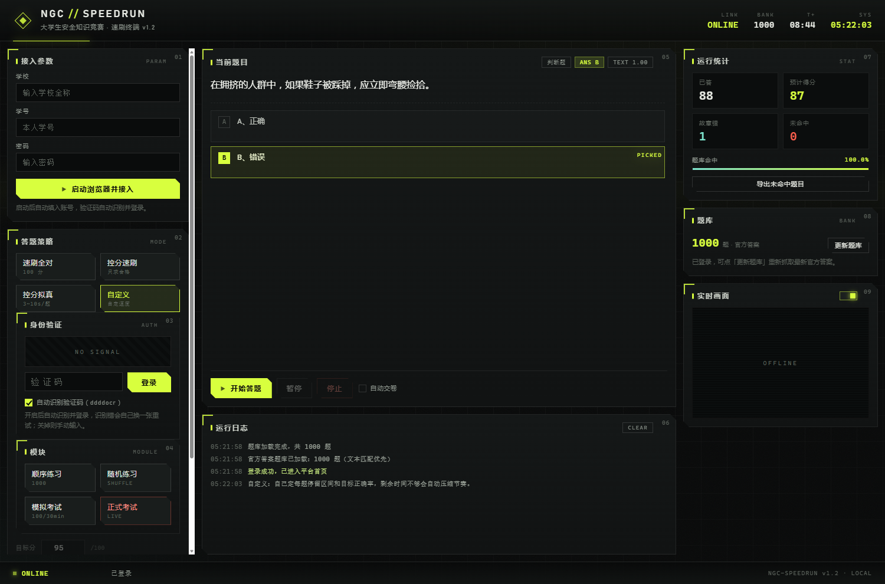
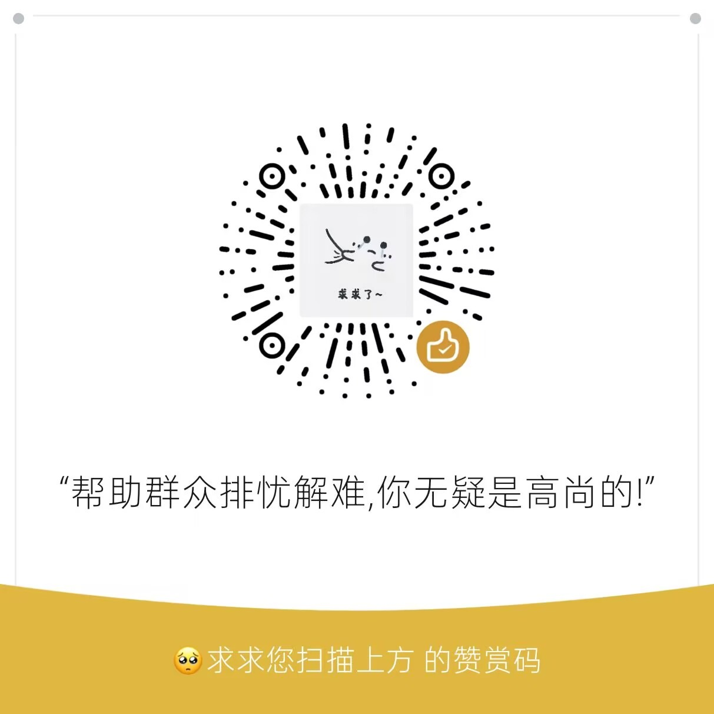

# 南京工程学院 · 大学生安全知识竞赛测试

南京工程学院大学生安全知识竞赛测试程序。CDP 直连浏览器。



## 免责声明

1. 本程序仅供学习研究，不得用于任何实际用途、商业用途或对外提供服务。
2. 程序按「现状」提供，不作任何明示或默示担保，包括可用性、稳定性与结果正确性。
3. 使用本程序产生的一切后果由使用者自行承担，包括但不限于成绩作废、账号处罚、纪律处分与法律责任。作者不承担任何责任。
4. 使用前请自行确认所在院校的规定与平台协议。操作对象须为本人账号。
5. 程序不采集、不上传个人信息。账号、密码、会话与日志仅存于本机。
6. 基于本程序修改、二次分发的版本，由修改者自行负责，与原作者无关。
7. 作者保留修改、暂停或终止更新的权利，不提供技术支持。下载或运行即视为接受本声明。

## 说明

程序做的事很简单：登录、读题、查库、点选项、交卷。中间不联网上报，不驻留后台，关窗即退。

题库来自平台自身的顺序练习，按选项文本匹配。选项顺序被打乱也不影响结果。

## 功能

- 自动登录，验证码本地 OCR 识别，识别失败自动换图重试
- 题库匹配，1000 题，文本比对
- 四种策略：速刷全对、控分速刷、控分拟真、自定义
- 自动交卷，可关闭
- 关窗口后端自动收工

## 下载

[Releases](../../releases) 里的 `NGC-AQJS.exe`，约 92 MB。

单文件，双击运行。

## 用法

1. 双击 exe，读完使用须知，进终端
2. 填学号、密码
3. 点「启动浏览器并接入」，等待登录
4. 选策略
5. 进答题页，点「开始答题」
6. 需要自动交卷就勾上，不需要就自己点「提 交」

中途可以暂停或停止。

## 目录结构

```
endfield/
├── main.py              入口：起服务、开 UI 壳、生命周期守护
├── core/
│   ├── cdp.py           WebSocket + CDP 客户端，浏览器管理
│   ├── engine.py        答题引擎：登录 / 采题 / 控分 / 节奏 / 交卷
│   ├── bank.py          题库解析与匹配
│   ├── server.py        ThreadingHTTPServer + chunked SSE
│   └── inject.js        页面内脚本
├── web/                 终端 UI
├── assets/
│   ├── answer.js        字母答案库
│   ├── bank_text.json   文本答案库
│   └── donate.jpg       赞赏码
└── build.py             打包脚本
```

源码运行：

```bash
python main.py
```

核心只用标准库。WebSocket 与 CDP 客户端是手写的，没有第三方运行时依赖。

## 使用许可

仅供学习研究。

禁止商用，禁止二次分发，禁止用于任何实际业务。

基于本程序修改的版本由修改者自行承担全部责任，与原作者无关。

## 赞赏

自愿。不影响任何功能。

<p align="center">
  
</p>
