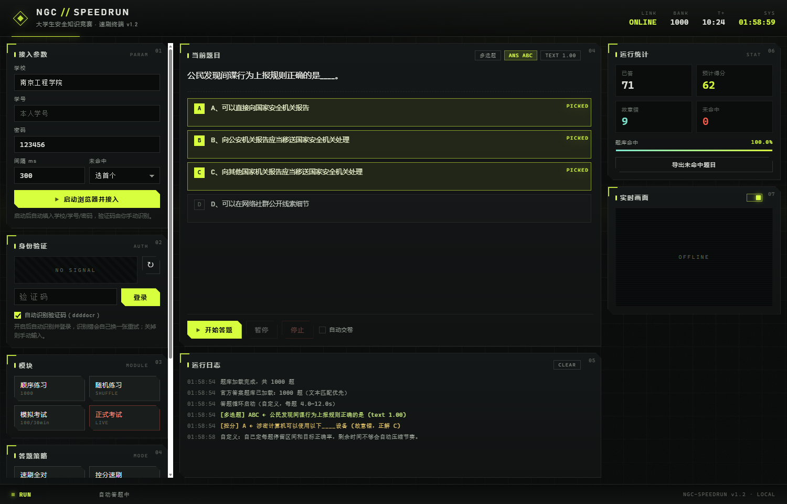

# NGC · 大学生安全知识竞赛速刷

南京工程学院安全知识竞赛的自动答题工具。CDP 直连浏览器，题库匹配，自动作答，自动交卷。



作者：璎珞（@yingluo） · 已开源 · 本项目完全免费

## 免责声明

1. 本程序为开源技术学习项目，用于网页自动化与 CDP 协议的学习实践。是否使用、如何使用，由使用者自行判断并承担全部后果。
2. 程序按「现状」（AS IS）提供，作者不对其可用性、稳定性、兼容性及使用结果作任何明示或默示担保。
3. 因使用或无法使用本程序造成的任何直接或间接损失（包括但不限于成绩作废、账号处罚、纪律处分及其他法律责任），作者不承担任何责任。
4. 请在使用前自行确认所在院校的相关规定与平台用户协议。使用者应自行确保操作对象为本人账号，答题记录代表本人真实水平。
5. 程序不采集、不上传任何个人信息。账号、密码、会话与运行日志仅保存在本机，不会发往任何第三方服务器。
6. 作者保留随时修改、暂停或终止更新的权利，且不承担技术支持义务。下载、运行即视为已阅读并接受本声明。

## 它能干什么

- 自动登录：账号密码 + 验证码 OCR（内置 ddddocr 模型，识别失败自动换图重试，也可切手动输入）
- 题库匹配：官方答案题库 1000 题，按选项**文本**匹配，选项顺序打乱也不影响
- 四种答题策略：速刷全对 / 控分速刷 / 控分拟真（3~10 秒一题）/ 自定义（自定速度和正确率）
- 自动交卷：答完自动提交，也可以关掉这个开关手动提交
- 多账号：支持批量，并发数自己定

## 下载

到 [Releases](../../releases) 下载 `NGC-大学生安全知识竞赛速刷.exe`（约 92 MB，单文件）。

不需要装 Python，不需要装 Chrome，双击就能跑。

## 怎么用

双击 exe，会弹一个「使用须知」，读完进终端。

然后这么操作：

1. 左上角填学号、密码（只存本机）
2. 点「启动浏览器并接入」——验证码会自动识别，识别错了会自动换一张再试
3. 左下角选策略。想快速过就选「速刷全对」；想分数好看又不想太假，选「控分拟真」
4. 点模块进答题页，再点「开始答题」，接下来它会自己走完：采题 → 匹配 → 点选 → 翻页
5. 勾了「自动交卷」的话，答完自动交。没勾就自己点「提 交」

中间想停就点「暂停」，想放弃点「停止」。

## 几个容易踩的坑

- **多选题全错**：Vue 会把连续的 `.click()` 合并成一次，界面上看着全选了，实际 model 里少一项。这版已经处理了（逐个点击 + 间隔 + 数量校验），但如果你自己改代码，注意这里
- **「提 交」按钮找不到**：按钮文本里带空格，匹配前要归一化，还要排除「(计时结束将自动提交)」这种提示语
- **滚动后坐标全错**：`scrollIntoView` 之后所有元素的 rect 都会变成同一个点，取坐标只能滚一次然后统一取值
- **登录按钮点不到**：那玩意是个 `<div>`，不是 `<button>`，按标签找永远找不到，得按文本找最内层元素

## 目录结构

```
endfield/
├── main.py              入口：起服务 + 开 UI 壳 + 生命周期守护
├── core/
│   ├── cdp.py           手写 WebSocket + CDP 客户端，浏览器管理
│   ├── engine.py        答题引擎：登录 / 采题 / 控分 / 节奏 / 交卷
│   ├── bank.py          题库：answer.js 解析 + 官方文本题库
│   ├── server.py        ThreadingHTTPServer + 手写 chunked SSE
│   └── inject.js        页面内脚本：probe / 点击 / 翻页 / 交卷
├── web/                 终端 UI（黑底酸绿）
├── assets/
│   ├── answer.js        字母答案库（兜底）
│   ├── bank_text.json   官方文本答案库（1000 题，优先）
│   └── donate.jpg       赞赏码
└── build.py             PyInstaller 打包脚本
```

源码运行：

```bash
python main.py
```

核心只依赖 Python 标准库——WebSocket 和 CDP 客户端是手写的，没有 websocket-client 依赖。

## License

MIT。修改、商用都行，保留本声明和作者署名就好。

## 赞赏

如果这东西帮你省了刷题时间，可以请作者喝一杯。完全自愿。

<p align="center">
  
</p>

<p align="center"><sub>赞赏码 · 帮助群众排忧解难，你无疑是高尚的</sub></p>
